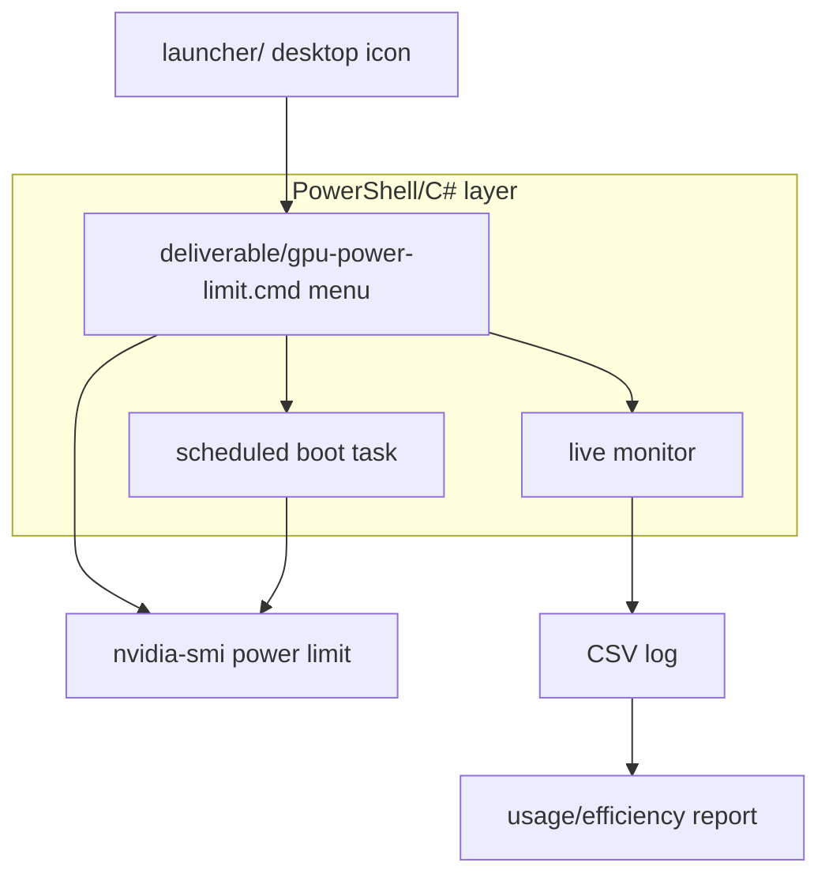
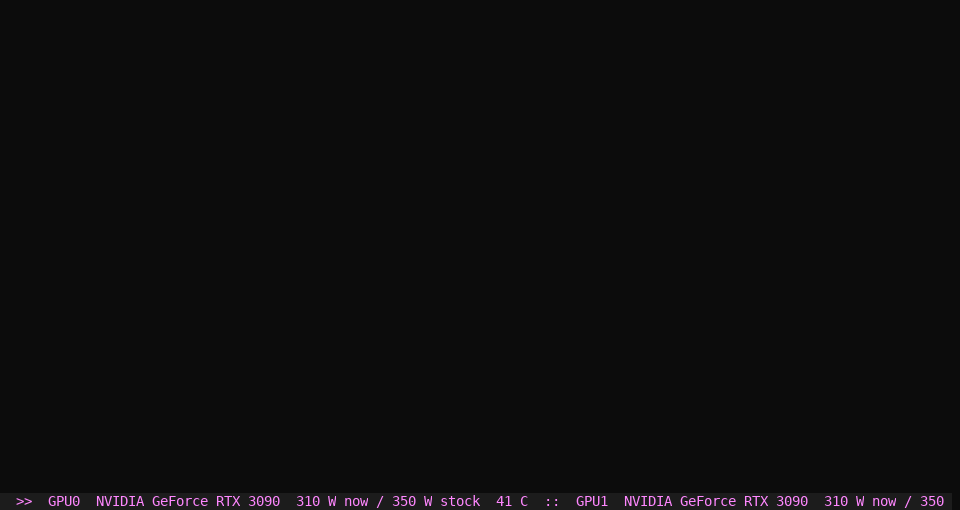
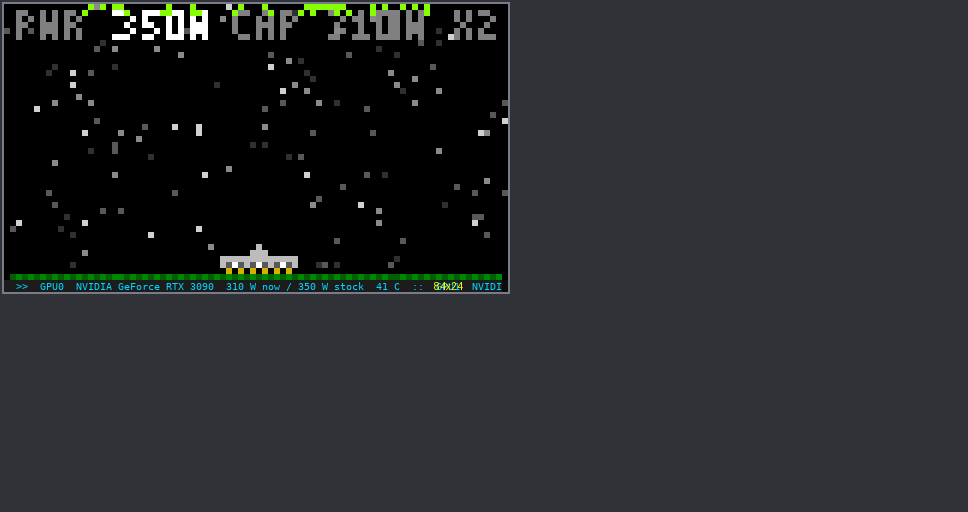

# WATTCAP
WATTCAP sets a power limit on every NVIDIA RTX 3090 in your PC, so the cards stay cooler and quieter at a lower wattage, and reapplies the limit every time Windows starts.

[](.github/workflows/ci.yml) [](LICENSE) 

It's a single Windows batch file, `deliverable/gpu-power-limit.cmd`, with a small PowerShell and C# layer for the boot task, the monitor, and the intro animation. There's an optional animated desktop-icon launcher in `launcher/`.

> **Warning:** this changes how hard your GPUs run. Use the reset option (`[2]`) to return to the stock limit at any time.

## Architecture



## Features

- Set a power limit on every 3090 at once, or on each card separately.
- Automatically reapply the limit at startup through a scheduled task.
- Live monitor: load, VRAM, power, clocks, throttle reasons, and CSV logging.
- Usage and efficiency report from the monitor log.
- Intro and outro animations, with a gallery to replay any of them.
- Desktop and Start menu shortcut with the WATTCAP logo.
- Full reset to stock limits, with the boot task removed.

## Requirements

- Windows 10 or 11.
- An NVIDIA RTX 3090 with a driver that includes `nvidia-smi.exe`.
- Administrator rights. The tool asks for them itself when it needs them.

Other NVIDIA cards can be used by changing the `MATCH` value at the top of the script, but only the 3090 is tested.

## Quick start

1. Download or clone this repository.
2. Double-click `deliverable/gpu-power-limit.cmd`, then accept the admin prompt.
3. Choose `[1]` to pick a wattage. The boot task is installed and the limit is applied straight away.
4. Choose `[3]` to confirm the current limit.

For a full walkthrough, including the desktop launcher and troubleshooting, see [docs/SETUP.md](docs/SETUP.md).

## Menu

| Key | Action |
|---|---|
| `1` | Set the power limit on every boot (pick watts) |
| `2` | Reset to stock (removes the boot task) |
| `3` | Show current limits |
| `4` | Create the desktop and Start menu shortcut |
| `M` | Live monitor |
| `S` | Usage and efficiency report |
| `F` | Profiles and per-card limits |
| `G` | Animation gallery |
| `H` | Help |
| `Q` | Quit |

## Where things are

| Path | What it is |
|---|---|
| `C:\ProgramData\GPUPowerLimit\` | Installed copy of the script, plus its logs and saved limits |
| `last-run.log` | Result of each boot-time apply |
| `monitor-log.csv` | Usage log written by the live monitor |
| `limits.txt` | Saved limits |
| Scheduled task `GPU Power Limit (3090)` | Applies the limit at startup, as SYSTEM |

## Repository layout

| Path | Contents |
|---|---|
| `deliverable/` | The finished script. This is the only file most people need. |
| `source/` | The pieces the script is built from, and `build.py`. |
| `launcher/` | Optional animated desktop-icon launcher (C#). |
| `history/` | Earlier versions, kept for reference. |
| `test-tools/` | Scripts used to capture animation frames and transcripts. |
| `docs/` | Setup, onboarding, testing, and code notes. |

## Building from source

```
cd source
python build.py
```

This writes `gpu-power-limit.cmd` into `source/`. Copy it into `deliverable/` to publish it. The launcher is built with `launcher\build.cmd` on Windows.

## Screenshots




## Documentation

- [Setup guide](docs/SETUP.md): installing, the desktop launcher, and troubleshooting.
- [CHANGES](CHANGES-v5.md): version history.
- [SUMMARY](SUMMARY.md): project summary.
- [Onboarding](docs/ONBOARDING.md): how the code is organised and where to start changing it.
- [Testing](docs/TESTING.md): automated checks and the hardware checklist.
- [Code summary](docs/WATTCAP-code-summary.md): a file-by-file tour.

## Contributing

Issues and pull requests are welcome. Before opening a pull request, run the drift check in [docs/TESTING.md](docs/TESTING.md) if you changed anything under `source/`, so the deliverable stays in step with the source.

## License

MIT. See [LICENSE](LICENSE).
